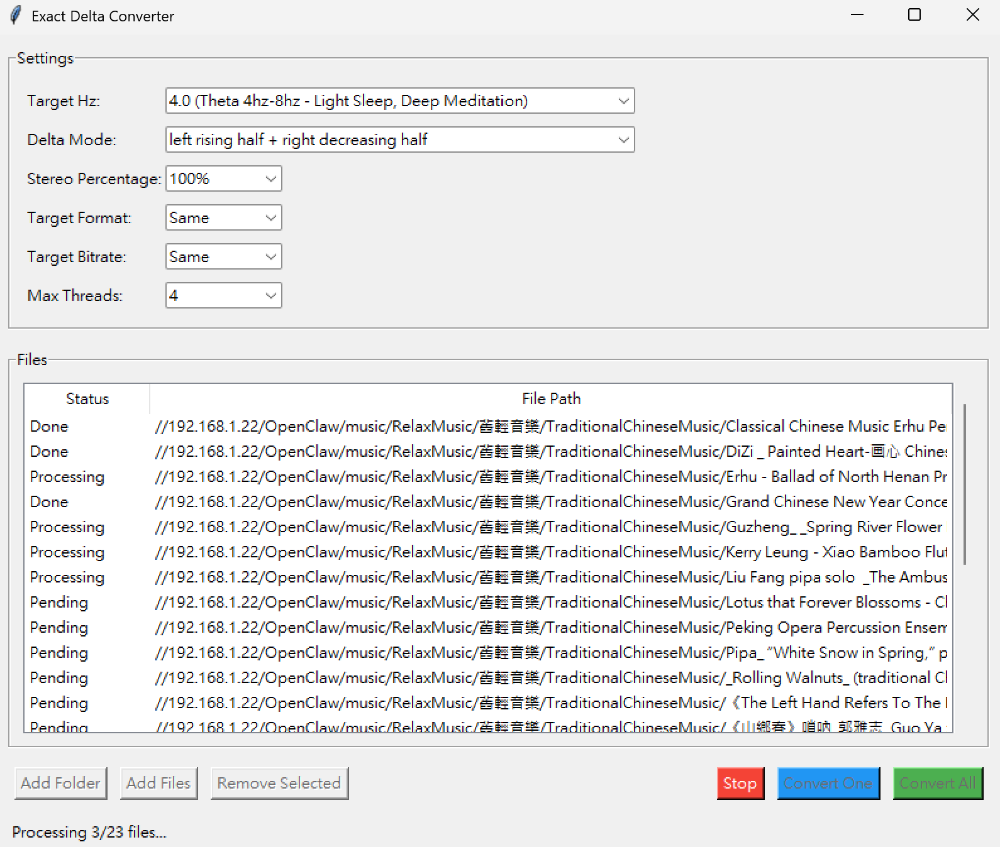

# Exact Delta Converter

<h2 align="center">⚠️ Notice: DO NOT LISTEN TO ExactDelta WHILE DRIVING. ⚠️</h2>

**Please use stereo headphones and turn off any audio enhancements such as Dolby Atmos.**

## Overview



Exact Delta Converter is a unique binaural beat generator that **does not add any artificial tones or background sounds** to your audio. Instead, it directly alters the frequency spectrum of the original audio file. 

By independently shifting the frequencies of the left and right channels by a specific target Hz, it creates a binaural beat using the music itself. This means you can listen to your favorite songs while experiencing the benefits of binaural beats, whether for deep sleep, relaxation, or peak focus.

## How it Works

The application achieves this pure frequency shift using the **Hilbert Transform**:
1. It computes the analytic signal of the audio using `scipy.signal.hilbert`.
2. It shifts the entire frequency spectrum uniformly without affecting the playback speed or tempo.
3. This creates a precise Hz difference (Delta) between the left and right ears, forming the binaural beat.

## Brainwave Science & ExactDelta Presets

### Contralateral Auditory Pathway Dominance (`LrRd` vs `LdRr`)
依據聽覺神經解剖學之**對側聽覺傳導優勢（Contralateral Auditory Pathway Dominance）**：人類耳蝸神經纖維經腦幹上橄欖核與外側丘系交叉後，約 **70%–80% 投射至對側大腦聽覺皮質**（即：**左耳輸入主導刺激右腦半球；右耳輸入主導刺激左腦半球**）。
- **`LrRd`（Left Rising + Right Decreasing：$L = +\Delta f/2,\; R = -\Delta f/2$）**：左耳頻率較右耳高出 $+\Delta f$ 且具正向升頻能量 $\implies$ **優先活化右腦半球（Right Hemisphere）**。
- **`LdRr`（Left Decreasing + Right Rising：$L = -\Delta f/2,\; R = +\Delta f/2$）**：右耳頻率較左耳高出 $+\Delta f$ 且具正向升頻能量 $\implies$ **優先活化左腦半球（Left Hemisphere）**。

### 六大腦波科學與靈性諧振 Presets

| 編號 | Preset 名稱 | 代表頻率 $\Delta f$ | 腦波頻帶 | 選定模式 | 左右耳位移 $(L / R)$ | 腦科學實證依據 & 靈性／宇宙諧波意義 | 車載行車安全分級 | 輸出前綴 |
| :---: | :--- | :---: | :--- | :---: | :---: | :--- | :---: | :---: |
| **1** | **放鬆**<br>(Relaxation) | **`7.83 Hz`** | $\alpha / \theta$ 臨界<br>(舒曼基頻) | **`LrRd`** | $L: +3.915\text{ Hz}$<br>$R: -3.915\text{ Hz}$ | **【腦科學】** 刺激**右腦**：抑制左腦語言區雜念，精準落於海馬迴 $\theta$ 與皮質 $\alpha$ 耦合交界，誘導全腦放鬆與自律神經 HRV 和諧。<br>**【靈性】** **地球舒曼共振基頻**，身心接地（Grounding）。 | 🟢 清醒安全<br>(Awake Safe) | `ExactDelta-Relax_***` |
| **2** | **專注**<br>(Focus) | **`15.68 Hz`** | Low-Mid Beta<br>($\beta$ 波) | **`LdRr`** | $L: -7.840\text{ Hz}$<br>$R: +7.840\text{ Hz}$ | **【腦科學】** 刺激**左腦**：精確驅動左前額葉背外側皮質（DLPFC）注意力、邏輯分析與工作記憶，避開焦躁高頻。<br>**【靈性】** 舒曼諧波系第 4 階倍頻（$4 \times 3.92\text{ Hz}$），象徵清明覺知。 | 🟢 行車推薦<br>(Driving Ideal) | `ExactDelta-Focus_***` |
| **3** | **冥想**<br>(Meditation) | **`4.32 Hz`** | Low Theta<br>(三摩地 $\theta$ 波) | **`LrRd`** | $L: +2.160\text{ Hz}$<br>$R: -2.160\text{ Hz}$ | **【腦科學】** 刺激**右腦**：深層內觀黃金區，促進非語言直覺洞察與潛意識整合而不落入昏睡。<br>**【靈性】** **432 Hz 百分之一分頻諧波**，貼近原始梵音 `OM`（$136.1\text{Hz} \div 2^5 = 4.25\text{Hz}$），神聖數 216 半移頻。 | 🟡 駐停限定<br>(Parked / Passenger) | `ExactDelta-Meditation_***` |
| **4** | **助眠**<br>(Sleep Aid) | **`1.96 Hz`** | Upper Delta<br>(入睡門檻 $\delta$ 波) | **`LrRd`** | $L: +0.980\text{ Hz}$<br>$R: -0.980\text{ Hz}$ | **【腦科學】** 刺激**右腦**：精確跨入 AASM N3 慢波睡眠臨床上限（`< 2.0 Hz`），關閉視丘感官閘門引導深睡。<br>**【靈性】** **大地舒曼諧波系 1/4 基頻**（$7.84 \div 4 = 1.96\text{ Hz}$），回歸母體懷抱安眠。 | 🔴 嚴禁駕駛使用<br>(Parked Nap Only) | `ExactDelta-SleepAid_***` |
| **5** | **深層睡眠**<br>(Deep Sleep) | **`0.75 Hz`** | Slow Oscillation<br>($<1\text{ Hz}$ 皮質慢波) | **`LrRd`** | $L: +0.375\text{ Hz}$<br>$R: -0.375\text{ Hz}$ | **【腦科學】** 刺激**右腦**：*Nature*（Marshall et al., 2006）臨床實證新皮質慢波振盪，啟動**腦部膠淋巴系統排毒與修復**。<br>**【靈性】** **`432 Hz` 與 `528 Hz` 在 `< 1 Hz` 唯一共同整除之最高神聖公因數基頻**（神聖網格數 144 倍數）。 | 🔴 嚴禁駕駛使用<br>(Sleep Only) | `ExactDelta-DeepSleep_***` |
| **6** | **消除壓力**<br>(Stress Relief) | **`11.76 Hz`** | Upper Alpha<br>(舒曼諧波高 $\alpha$) | **`LdRr`** | $L: -5.880\text{ Hz}$<br>$R: +5.880\text{ Hz}$ | **【腦科學】** 刺激**左腦**：依據 Davidson 前額葉情緒側化，提振左前額葉拮抗右腦與杏仁核焦慮迴路，建立平穩情緒韌性。<br>**【靈性】** 舒曼諧波系第 3 階倍頻（$3 \times 3.92\text{ Hz}$），平衡穩定氣場。 | 🟢 通勤推薦<br>(Commute Ideal) | `ExactDelta-StressRelief_***` |

## Quick Start

### 1. Install Requirements
Ensure you have Python 3.7+ installed.

**Install Python packages:**
```bash
pip install -r requirements.txt
```

**Install FFmpeg (Windows):**
*(Required for MP3 support)*
```bash
conda install ffmpeg
```

### 2. Run the App
```bash
python main.py
```
